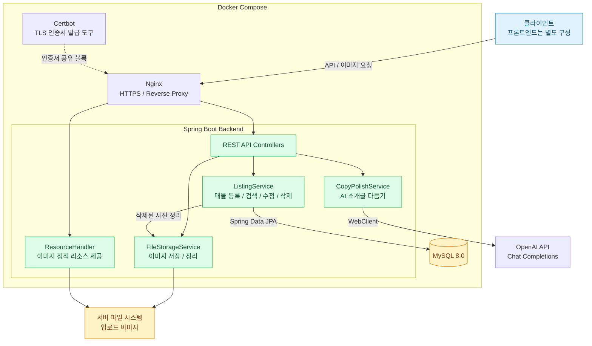
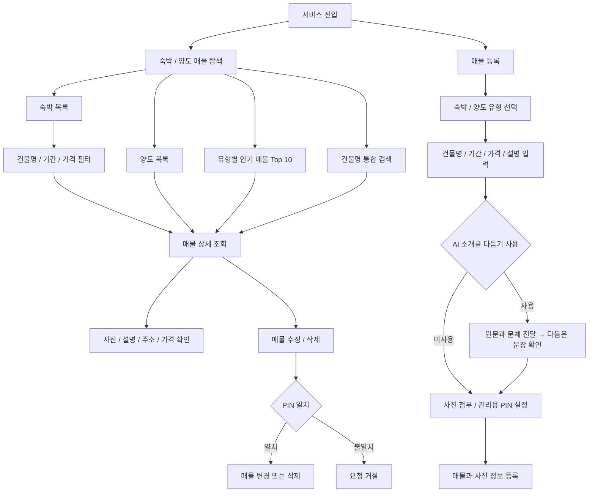
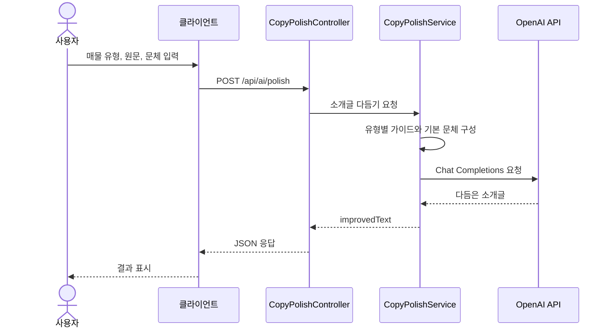

#  Fit-Room

> 나에게 맞는 공간을 찾고, 공간의 매력을 더 쉽게 전하다.

**Fit-Room**은 숙박·양도 매물을 등록하고, 건물명·기간·가격 조건으로 탐색할 수 있는 매물 정보 플랫폼입니다. 사진과 상세 정보를 함께 등록하고, OpenAI를 활용해 매물 소개글을 자연스럽게 다듬을 수 있습니다.

이 저장소는 Fit-Room의 **백엔드 API**를 담당합니다. 숙박·양도 매물 관리, 이미지 업로드, 조건 검색, 조회수 기반 인기 매물, PIN 기반 수정·삭제, AI 소개글 다듬기를 구현했습니다.

##  프로젝트 아키텍처

Spring Boot가 매물 API와 이미지 제공을 담당하고, MySQL에 매물 정보와 이미지 경로를 저장합니다. AI 소개글 다듬기는 WebClient를 통해 OpenAI API와 연동합니다.

아래 배포 구성은 저장소의 Docker Compose와 Nginx 설정을 기준으로 작성했습니다.



##  프로젝트 목표

1. **숙박·양도 매물 정보를 한곳에서 탐색**

   숙박과 양도 매물을 공통 구조로 관리하면서, 유형별 목록과 상세 정보를 제공합니다.

2. **기간과 예산을 고려한 매물 검색**

   건물명, 이용 기간, 최소·최대 가격 조건을 조합해 숙박 매물을 검색할 수 있도록 구성했습니다.

3. **매물 소개글 작성 부담 완화**

   사용자가 작성한 원문과 매물 유형, 원하는 문체를 바탕으로 AI가 자연스러운 소개글을 제안합니다.

4. **사진을 포함한 간편한 매물 등록**

   하나의 요청에서 매물 정보와 여러 장의 이미지를 함께 전달할 수 있도록 멀티파트 등록 API를 제공합니다.

5. **매물 데이터와 이미지의 생명주기 관리**

   매물 수정·삭제 시 DB 변경이 커밋된 뒤 제거 대상 이미지 파일을 정리하도록 구성했습니다.

##  사용 기술

| 영역 | 기술 | 활용 |
| --- | --- | --- |
| Language | Java 21 | 백엔드 개발 |
| Framework | Spring Boot 3.5.4, Spring Web MVC | REST API 구현 |
| Persistence | Spring Data JPA, Hibernate | 매물·사진 데이터 저장 및 조회 |
| Database | MySQL 8.0 | 관계형 데이터 관리 |
| AI Integration | OpenAI API, Spring WebClient | 매물 소개글 다듬기 |
| Serialization | Jackson, JavaTimeModule | JSON 처리와 날짜 직렬화 |
| File Storage | Java NIO, MultipartFile | 이미지 업로드·삭제 |
| Build | Gradle 8.14.3, Lombok | 빌드와 반복 코드 축소 |
| Deployment | Docker, Docker Compose, Nginx, Certbot | 컨테이너 실행과 HTTPS 구성 |
| Test | Spring Boot Test, JUnit 5 | 애플리케이션 컨텍스트 로딩 테스트 |

##  프로토타입 · 사용자 흐름

백엔드 API가 지원하는 기능을 기준으로 정리한 사용자 흐름도입니다.



##  주요 기능

### 1. 숙박·양도 매물 등록

- `STAY`와 `TRANSFER`로 매물 유형 구분
- 건물명, 설명, 주소, 기간, 인원, 가격 정보 등록
- 매물 정보 JSON과 여러 이미지 파일을 한 번에 전송
- 생성 시각과 수정 시각 자동 기록
- 매물 관리를 위한 PIN 저장

### 2. 유형별 목록과 상세 조회

- 숙박·양도 매물 목록을 각각 조회
- 목록에서 대표 이미지, 건물명, 가격 등 카드용 정보 제공
- 상세 화면에 사용할 전체 사진, 설명, 주소, 기간 등 반환
- 상세 조회 요청 시 조회수 증가

### 3. 조건 검색

- 건물명을 기준으로 숙박·양도 매물 통합 검색
- 숙박 매물에 건물명, 시작일, 종료일, 최소·최대 가격 필터 적용
- 건물명은 대소문자를 구분하지 않는 부분 일치 검색
- 날짜는 검색 기간과 매물 기간이 겹치는 조건으로 조회
- 가격은 매물에 저장된 총 금액 기준으로 비교

### 4. 인기 매물 Top 10

- 숙박·양도 유형별 인기 매물 조회
- 조회수가 높은 매물을 우선 정렬
- 조회수가 같으면 최근 등록된 매물을 우선 정렬
- 대표 이미지와 유형별 요약 정보를 함께 반환

### 5. AI 소개글 다듬기

- 매물 유형, 원문, 원하는 문체를 입력받아 소개글 생성
- 숙박 매물은 기간·인원·위치 중심의 작성 가이드 적용
- 양도 매물은 가성비·입지 등 장점 중심의 작성 가이드 적용
- 문체를 지정하지 않으면 `따뜻하고 담백한 톤` 사용
- 한국어 2~4문장의 한 단락을 요청하도록 프롬프트 구성
- OpenAI의 `429 Too Many Requests` 응답에 최대 3회 백오프 재시도

### 6. PIN 기반 수정·삭제

- 등록 시 지정한 PIN과 요청 PIN이 일치하는 경우에만 수정·삭제
- 수정 요청에 포함된 값으로 매물 정보 갱신
- 사진 목록을 전달하면 기존 사진 목록 교체
- DB 변경 커밋 이후 제거된 이미지 파일 정리

### 7. 이미지 업로드와 제공

- 단일·다중 이미지 업로드 API 제공
- MIME 타입 또는 확장자를 기준으로 업로드 형식 확인
- UUID 기반 파일명으로 저장
- 월별 디렉터리로 업로드 파일 분리
- `/images/**` 경로로 이미지 제공
- 파일 경로 정규화와 업로드 디렉터리 범위 검사

##  AI 소개글 처리 흐름



AI API는 다듬은 문장을 반환하며, 매물 등록·수정은 별도 API로 처리합니다.

##  데이터 모델

`Listing`을 중심으로 상세 정보, 기간, 가격을 임베디드 값 객체로 구성하고, 사진은 별도 엔티티로 관리합니다.

| 구성 요소 | 주요 필드 | 역할 |
| --- | --- | --- |
| `Listing` | `id`, `type`, `viewCount`, `pin`, `createdAt`, `updatedAt` | 매물의 식별·유형·관리 정보 |
| `ListingDetails` | `buildingName`, `description`, `address` | 매물 상세 정보 |
| `ListingPeriod` | `startDate`, `endDate`, `guests` | 이용 기간과 인원 |
| `ListingPricing` | `price` | 총 금액 |
| `ListingPhoto` | `id`, `url`, `listing` | 매물에 연결된 이미지 |

`ListingDetails`, `ListingPeriod`, `ListingPricing`은 별도 테이블이 아닌 `listings` 테이블의 컬럼으로 저장됩니다. `ListingPhoto`는 `listing_photos` 테이블에서 매물과 다대일 관계를 맺습니다.

### 구현 포인트

- **목록·상세 응답 분리**: 화면 용도에 맞는 DTO로 필요한 정보를 반환합니다.
- **연관 데이터 조회**: `@EntityGraph`로 사진 등 조회에 필요한 연관 데이터를 함께 가져오도록 지정했습니다.
- **조회수 증가**: DB에서 `viewCount = viewCount + 1`을 수행해 동시에 들어온 증가 요청의 갱신 손실을 줄입니다.
- **커밋 후 파일 정리**: 매물 수정·삭제 트랜잭션이 커밋된 이후 실제 이미지 파일 삭제를 시도합니다.

##  주요 API

### 매물

| Method | Endpoint | 설명 |
| --- | --- | --- |
| `POST` | `/api/listings/with-upload` | 매물 정보와 이미지 함께 등록 |
| `GET` | `/api/listings/stay` | 숙박 매물 목록 |
| `GET` | `/api/listings/transfer` | 양도 매물 목록 |
| `GET` | `/api/listings/stay/{id}` | 숙박 매물 상세 |
| `GET` | `/api/listings/transfer/{id}` | 양도 매물 상세 |
| `GET` | `/api/listings/stay/search` | 숙박 조건 검색 |
| `GET` | `/api/listings/search` | 건물명 통합 검색 |
| `GET` | `/api/listings/top/stay` | 인기 숙박 매물 Top 10 |
| `GET` | `/api/listings/top/transfer` | 인기 양도 매물 Top 10 |
| `PATCH` | `/api/listings/{id}` | PIN 검증 후 매물 수정 |
| `DELETE` | `/api/listings/{id}` | PIN 검증 후 매물 삭제 |

매물 등록 요청은 `multipart/form-data`로 전송합니다.

- `data`: 매물 정보 JSON 문자열
- `files`: 이미지 파일 목록, 선택 항목

수정 PIN은 JSON 본문에, 삭제 PIN은 `pin` 쿼리 파라미터에 전달합니다.

### 이미지·AI

| Method | Endpoint | 설명 |
| --- | --- | --- |
| `POST` | `/api/uploads/image` | 단일 이미지 업로드 |
| `POST` | `/api/uploads/images` | 다중 이미지 업로드 |
| `POST` | `/api/ai/polish` | AI 소개글 다듬기 |
| `GET` | `/images/**` | 업로드 이미지 조회 |

### AI 요청 예시

```json
{
  "type": "STAY",
  "rawText": "역에서 걸어서 5분이고 방이 조용합니다. 근처에 편의점이 있습니다.",
  "tone": "따뜻하고 담백한 톤"
}
```

응답 형식은 다음과 같습니다. 문장 내용은 생성 결과에 따라 달라집니다.

```json
{
  "improvedText": "역에서 도보 5분 거리에 있어 이동이 편리합니다. 조용한 방에서 편안하게 머물 수 있으며, 가까운 편의점도 이용할 수 있습니다."
}
```

##  프로젝트 구조

```text
Fit-Room/
├── src/
│   ├── main/
│   │   ├── java/org/likelion/hsu/likelion_hackathon/
│   │   │   ├── Config/          # CORS, JSON, OpenAI, 정적 리소스, 예외 처리
│   │   │   ├── Controller/      # 매물, 업로드, AI API
│   │   │   ├── Dto/
│   │   │   │   ├── Request/     # 등록·수정·AI 요청
│   │   │   │   └── Response/    # 목록·상세·AI 응답
│   │   │   ├── Entity/          # 매물과 사진, 임베디드 값 객체
│   │   │   ├── Enum/            # STAY / TRANSFER
│   │   │   ├── Repository/      # JPA 저장소와 검색 쿼리
│   │   │   └── Service/         # 매물, 파일 저장, 소개글 처리
│   │   └── resources/
│   │       └── application.yml
│   └── test/                   # 컨텍스트 로딩 테스트
├── gradle/wrapper/
├── nginx/
│   └── ngnix.conf              # 저장소에 포함된 실제 파일명
├── Dockerfile
├── docker-compose.yml
├── build.gradle
└── settings.gradle
```

##  로컬 실행 방법

### 1. 실행 환경 준비

- JDK 21
- MySQL 8.0
- OpenAI API Key
- 이미지를 저장할 쓰기 가능한 로컬 디렉터리

MySQL에 사용할 데이터베이스와 계정을 먼저 준비합니다. Gradle은 저장소의 Wrapper를 사용합니다.

### 2. 환경 변수 설정

macOS·Linux 터미널 기준 예시입니다. 값은 자신의 환경에 맞게 변경합니다.

```bash
export DB_HOST=localhost
export DB_PORT=3306
export DB_NAME=fitroom
export DB_USER=your-db-user
export DB_PASSWORD='your-db-password'

export OPENAI_API_KEY='your-openai-api-key'
export OPENAI_MODEL=gpt-4o-mini

export APP_UPLOAD_DIR="$PWD/uploads"
mkdir -p "$APP_UPLOAD_DIR"
```

| 변수 | 설명 |
| --- | --- |
| `DB_HOST` | MySQL 호스트 |
| `DB_PORT` | MySQL 포트 |
| `DB_NAME` | 사용할 데이터베이스 |
| `DB_USER` | DB 계정 |
| `DB_PASSWORD` | DB 비밀번호 |
| `OPENAI_API_KEY` | OpenAI API 인증 키 |
| `OPENAI_MODEL` | 사용할 모델, 기본값 `gpt-4o-mini` |
| `OPENAI_BASE_URL` | Chat Completions 요청 URL |
| `APP_UPLOAD_DIR` | 이미지 저장 경로 |

현재 OpenAI 클라이언트는 애플리케이션 시작 시 키 설정을 확인합니다. `OPENAI_ENABLED=false`만으로 클라이언트 생성을 비활성화하는 로직은 구현되어 있지 않습니다.

### 3. 애플리케이션 실행

```bash
chmod +x gradlew
./gradlew bootRun
```

기본 API 주소는 `http://localhost:8080`입니다.

```bash
curl http://localhost:8080/api/listings/stay
```

로컬 프론트엔드와 연동할 때는 `CorsConfig`에 해당 개발 서버의 Origin을 추가해야 합니다. 현재 설정에는 지정된 프론트엔드 배포 주소만 허용되어 있습니다.

##  Docker 배포 구성

저장소에는 다음 서비스가 정의되어 있습니다.

| 서비스 | 역할 |
| --- | --- |
| `db` | MySQL 실행과 DB 데이터 보관 |
| `backend` | Spring Boot 애플리케이션 실행 |
| `nginx` | 외부 요청 프록시와 HTTPS 처리 |
| `certbot` | TLS 인증서 발급 도구 |

Dockerfile은 JDK 이미지에서 애플리케이션을 빌드하고, JRE 이미지에서 실행하는 다단계 구조입니다. 실행 시 `prod` 프로필과 `PORT` 환경 변수를 사용하며, 기본 포트는 `8080`입니다.

### 배포 전 설정

- 루트 `.env`에 DB와 OpenAI 환경 변수를 설정합니다.
- Compose 내부 DB 접속에는 `DB_HOST=db`, `DB_PORT=3306`을 사용합니다.
- MySQL 초기화에 필요한 `MYSQL_ROOT_PASSWORD`도 지정합니다.
- 실제 파일명은 `nginx/ngnix.conf`이지만 Compose는 `nginx/nginx.conf`를 참조하므로 경로를 일치시켜야 합니다.
- Nginx의 도메인과 인증서 경로를 배포 환경에 맞게 설정하고 인증서를 준비합니다.
- 업로드 이미지를 컨테이너 재생성 후에도 유지하려면 이미지 저장 디렉터리에 별도 영속 볼륨을 연결해야 합니다. 현재 Compose에는 DB·인증서 볼륨만 정의되어 있습니다.

위 설정을 완료한 뒤 실행합니다.

```bash
docker compose up -d --build db backend nginx
docker compose ps
docker compose logs -f backend
```

##  빌드와 테스트

```bash
# 테스트
./gradlew test

# 테스트를 포함한 빌드
./gradlew build
```

현재 테스트 코드는 Spring Boot 애플리케이션 컨텍스트 로딩을 확인합니다. 테스트 실행에도 DB 연결과 OpenAI 클라이언트 초기화에 필요한 환경 설정이 필요합니다.

##  구현 범위

현재 저장소는 매물 등록·조회·검색·관리와 AI 소개글 다듬기를 제공하는 백엔드입니다. 매물 관리에는 PIN 검증을 사용하며, 회원 로그인·예약 확정·결제 기능은 포함되어 있지 않습니다.
